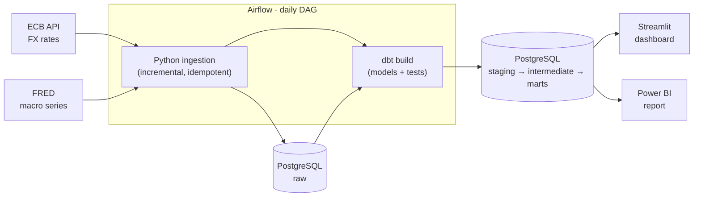

# Financial Data Platform


An end-to-end **ELT pipeline** on public financial data: daily euro exchange rates from the **European Central Bank** and US macroeconomic indicators from **FRED**, ingested with Python, orchestrated with **Airflow**, modelled and tested with **dbt** on **PostgreSQL**, and served in a **Streamlit** dashboard.

The whole stack runs locally with one command and needs **no API keys**.

> Independent personal project built on publicly available data. Not investment advice.

---

## The business problem

A treasury team of a euro-area company wants to monitor its **FX exposure** (how the euro moves against USD, GBP, JPY, CHF, CNY, and how volatile it is) next to the main **US macro indicators** (inflation, unemployment, interest rates).
The data is public but scattered, and copying CSV files into spreadsheets by hand is slow and error-prone.

**This project automates the whole flow, from raw API data to tested KPIs.**
Full requirements and acceptance criteria: [docs/requirements.md](docs/requirements.md).

## Architecture



| Layer | Tool | What happens |
|---|---|---|
| Extract & Load | Python (`src/findata`) | Download CSV from the APIs, parse into typed records, **upsert** into `raw` |
| Orchestration | Airflow 3 | Weekday schedule, retries, task dependencies |
| Transform | dbt | `staging` (clean) → `intermediate` (logic) → `marts` (star schema) |
| Data quality | dbt tests + pytest | Keys, nulls, referential integrity, plausibility checks, parser unit tests |
| Serve | Streamlit · Power BI | Same marts, two consumers: a reproducible web app and a business report |
| CI | GitHub Actions | Lint, unit tests, and a full `dbt build` on a bundled data sample |

More detail and the data model: [docs/architecture.md](docs/architecture.md).

## Data model

- `dim_date`, `dim_currency`, `dim_indicator` — dimensions
- `fct_fx_rates_daily` — one row per currency per day: rate, daily return, 20-day annualised volatility
- `fct_macro_indicators_monthly` — one row per indicator per month: value, MoM and YoY change
- `rpt_macro_fx_monthly` — one row per month, ready for the dashboard

## Power BI report

The same star schema feeds a two-page Power BI report (Overview, FX Risk) with DAX measures for latest values, period change and volatility.
Model, relationships and measures are documented in [powerbi/README.md](powerbi/README.md).

<!-- Uncomment once the screenshots are in docs/img/


-->

## Quick start

Requirements: Docker Desktop.

```bash
git clone https://github.com/ang-ai-tech/financial-data-platform.git
cd financial-data-platform
cp .env.example .env
docker compose up -d --build
```

1. Open Airflow at <http://localhost:8080> and trigger the **`findata_daily`** DAG.
   The first run loads history from 2015 (about a minute).
2. Open the dashboard at <http://localhost:8501>.

Offline? Load the bundled snapshot instead of calling the APIs:

```bash
docker compose exec airflow findata load-sample --dir /opt/findata-sample
```

Run the unit tests locally:

```bash
pip install -e ".[dev]"
pytest
```

## Key design decisions

| Decision | Why | ADR |
|---|---|---|
| PostgreSQL as warehouse | Free, runs in Docker, shared by all services | [0001](docs/decisions/0001-postgres-as-warehouse.md) |
| FRED CSV endpoint instead of the API | No API key needed → anyone can run the project | [0002](docs/decisions/0002-fred-csv-endpoint.md) |
| ELT with layered dbt models | Raw data kept as-is; all logic in tested, versioned SQL | [0003](docs/decisions/0003-elt-with-dbt-layers.md) |
| dbt in its own virtualenv | Avoids dependency conflicts with Airflow | [0004](docs/decisions/0004-dbt-isolated-venv.md) |

**Incremental and idempotent loads.** Each run starts from the latest date already in the warehouse minus a look-back window (7 days for FX, 120 days for macro data, which gets revised) and upserts on the natural key. Running the pipeline twice gives the same result as running it once.

## Project structure

```
├── config/sources.yml      # currencies and series to load (no code change needed)
├── src/findata/            # Python ingestion package
│   ├── extract/            # ECB and FRED: fetch + parse
│   ├── load.py             # idempotent upserts + run log
│   ├── pipeline.py         # incremental logic
│   └── cli.py              # `findata ingest | load-sample | export-sample`
├── dags/                   # Airflow DAG
├── dbt/                    # dbt project: models, tests, seeds, macros
├── dashboard/              # Streamlit app
├── data/sample/            # small real-data snapshot used by CI
├── tests/                  # pytest unit tests
└── docs/                   # requirements, architecture, decisions (ADR)
```

## Limitations & next steps

- Single-container Airflow (`standalone`): fine for a demo, not for production.
- The marts are rebuilt in full on every run; with more data, `fct_fx_rates_daily` would become an incremental model.
- No alerting: failed runs are visible in Airflow and in `raw.ingestion_log` only.
- Possible extensions: more currencies, alerting on failed runs, deployment to a cloud warehouse.

## Data sources & attribution

- **European Central Bank** — euro foreign exchange reference rates, [ECB Data Portal](https://data.ecb.europa.eu/). Source: ECB statistics.
- **FRED®, Federal Reserve Bank of St. Louis** — series CPIAUCSL, UNRATE, FEDFUNDS, DGS10 ([fred.stlouisfed.org](https://fred.stlouisfed.org/)). Original sources: U.S. Bureau of Labor Statistics, Board of Governors of the Federal Reserve System.

## License

[MIT](LICENSE)
