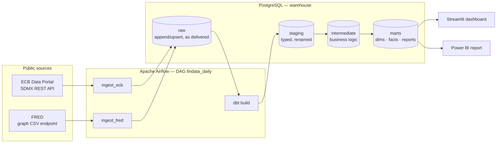
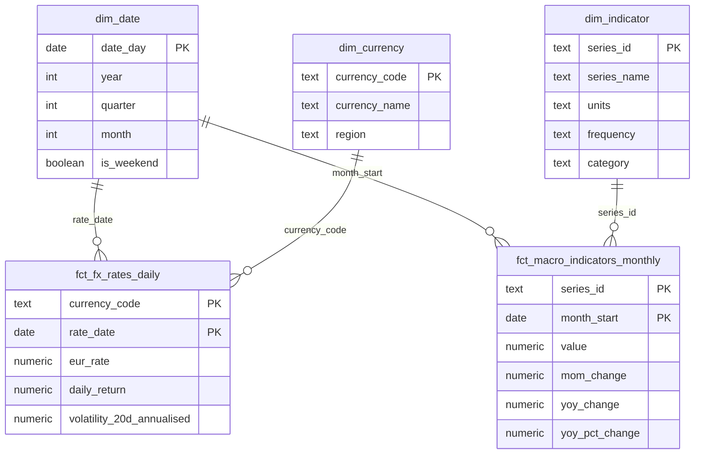

# Architecture

## Layers

| Layer | Owner | Materialisation | Purpose |
|---|---|---|---|
| `raw` | Python (`findata`) | tables, upsert on natural key | Data exactly as delivered + load metadata (`_loaded_at`, `_batch_id`) |
| `staging` | dbt | views | 1:1 with sources: rename, cast, no business logic |
| `intermediate` | dbt | views | Reusable logic: returns, volatility, monthly aggregation |
| `marts` | dbt | tables | Star schema for BI: `dim_*`, `fct_*`, `rpt_*` |

## Data model (marts)

`rpt_macro_fx_monthly` is a wide, denormalised table (one row per month) built for the dashboard.

## Incremental ingestion

On every run the loader asks the warehouse for the latest date already loaded per source and re-reads from `latest_date - lookback_days`:

- ECB: 7 days (late publications are rare but possible);
- FRED: 120 days (macro series are **revised** after first release).

Rows are upserted on the natural key (`currency, rate_date` / `series_id, observation_date`), so re-reading overlapping windows is safe. `--full-refresh` reloads from `FINDATA_START_DATE`.

## Runtime (Docker Compose)

| Service | Image | Port |
|---|---|---|
| `postgres` | `postgres:16` | 5432 — databases `warehouse` and `airflow` |
| `airflow` | custom, based on `apache/airflow:3.3.2-python3.12` | 8080 |
| `dashboard` | custom, `python:3.12-slim` + Streamlit | 8501 |

dbt runs inside the Airflow container from an isolated virtualenv (`/opt/dbt-venv`) — see ADR 0004.
